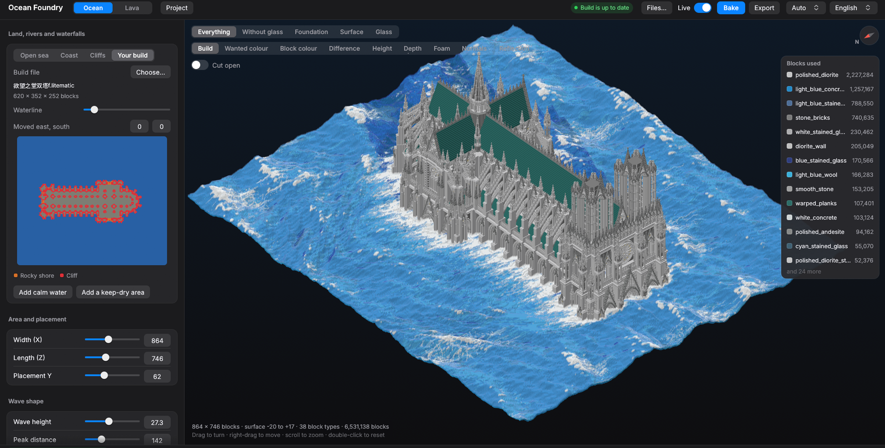
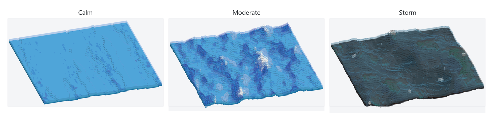
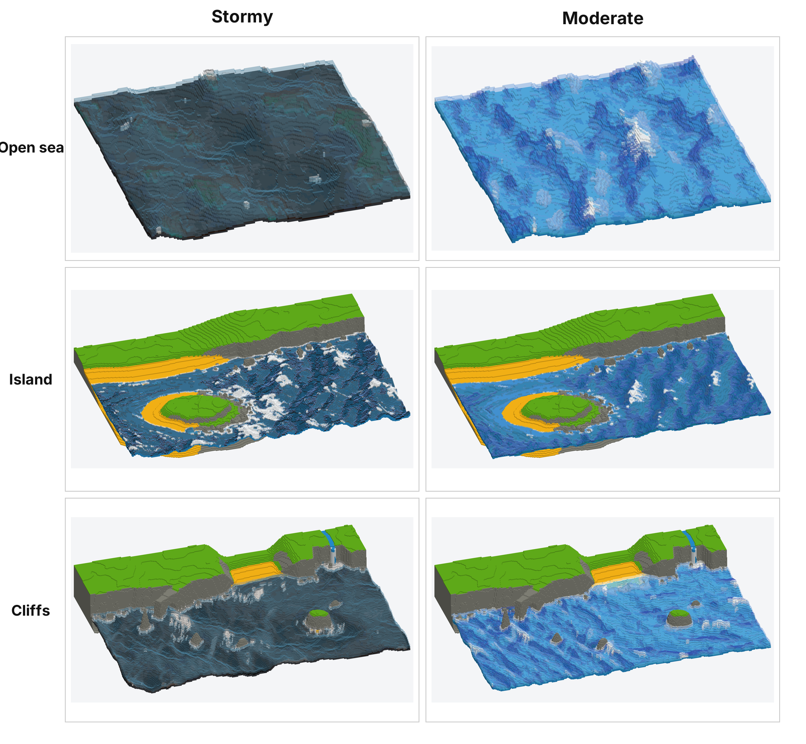

# Ocean Foundry

**中文** | [English](#english)

**把一片海，变成可以放进 Minecraft 的方块建筑。**

Ocean Foundry 是一个便携、离线的 Windows 桌面应用。调好一片水域，实时预览它变成混凝土、彩色方块和染色玻璃组成的建筑；选中满意的一刻，烘焙，然后导出为 Litematica、WorldEdit/Sponge 或 Axiom 文件。



*图中的教堂建筑由 B 站 UP 主 [伯亚](https://space.bilibili.com/399577290) 制作，导入 Ocean Foundry 作为预览场景。*
*Cathedral build by [伯亚](https://space.bilibili.com/399577290) on Bilibili, imported into Ocean Foundry for this preview.*

> **版本说明：** 这个仓库是 **Ocean Foundry 的 Rust 重写版 v0.1.0**，也是当前较新的版本。早先的 Python v1.3 版本在 [SirChomuske/ocean-foundry](https://github.com/SirChomuske/ocean-foundry)。

## ⬇️ 下载

从 [Releases](https://github.com/SirChomuske/ocean-foundry-rust/releases) 下载最新版：

| 文件 | 内容 |
|---|---|
| `OceanFoundry-0.1.0-win64.zip` | Windows x64 便携版：GUI、CLI、示例建筑文件，以及三组开阔海面测试 |

把整个文件夹解压出来，运行 `OceanFoundry.exe`。不要直接在 ZIP 里运行。

设置、导入的贴图和导出的文件都保存在程序旁边的 `OceanFoundry-data` 文件夹；如果那里不可写，就使用 `%LOCALAPPDATA%\OceanFoundry`。删掉这个文件夹即可恢复初始状态。

**系统要求：** 64 位 Windows 10 / 11。目标版本是 **Minecraft Java 26.1.2**。

## 功能

- **开阔海面**：设置范围和放置高度，用浪高、浪峰间距调整涌浪，切开水面、留出干燥区域、加入平静水面。
- **实时预览**：旋转查看，切换成品方块、地基、表面、玻璃，以及高度、深度、泡沫、法线、反射等视图；右侧调色板会列出实际用到的方块和数量。
- **烘焙一次，到处导出**：把预览冻结成静态建筑，写成 `.litematic`、`.schem` 或 `.bp`。
- **导入自己的建筑**：载入已有建筑查看。
- **改颜色不用重新算水**：基础色、亮部色、阳光、浅水提亮、泡沫、波浪和涟漪阴影都在水面结果之后应用，所以调整很便宜。还有前后对比视图。
- **能跑就行**：通过 wgpu 使用 D3D12/Vulkan，带 CPU 回退；英文和简体中文界面；无需安装、无需账号、不联网。

## 预览



*平静、中等、风暴三种海面设置。*



*开阔海、小岛和悬崖；左边 stormy，右边 moderate。*

## 快速开始

1. 下载并解压 `OceanFoundry-0.1.0-win64.zip`。
2. 运行 `OceanFoundry.exe`。
3. 选择 **Open sea** 或 **Your build**，设置范围和浪形。
4. 预览满意后按 **Bake**。
5. 打开 **Export**，选择 Litematica、WorldEdit/Sponge 或 Axiom，保存。
6. 用对应的 mod 或插件把文件放进 Minecraft。

**视图操作：** 拖动旋转 · 右键拖动平移 · 滚轮缩放 · 双击复位。

## 格式

| 格式 | 读取 | 写入 | 用于 |
|---|---|---|---|
| `.litematic` | 支持 | 支持 | Litematica |
| `.schem` | 支持 | 支持 | WorldEdit / Sponge |
| `.schematic` | 支持 | 不支持 | 旧版 WorldEdit |
| `.bp` | 支持 | 支持 | Axiom |

导出的是静态建筑。Ocean Foundry 不会直接往世界里放方块；你需要用 Litematica、WorldEdit 或 Axiom 粘贴，并自己确认位置。

## 从源码构建

需要较新的稳定版 Rust（edition 2024）和 Windows 上的 PowerShell。

```powershell
git clone https://github.com/SirChomuske/ocean-foundry-rust.git
cd ocean-foundry-rust

cargo test --workspace --release
pwsh -NoProfile -File scripts/package.ps1
```

`package.ps1` 会跑测试、用 `+crt-static` 构建、整理便携文件夹，并生成 `dist/OceanFoundry-0.1.0-win64.zip`。

## 项目结构

| 路径 | 作用 |
|---|---|
| `crates/of-ocean` | 场景设置、水面模拟、烘焙和方块布局 |
| `crates/of-formats` | Litematica、Sponge、Axiom 读写，NBT 和打包 |
| `crates/of-gpu` | wgpu 设备设置和 GPU 辅助 |
| `crates/of-app` | egui 桌面应用 |
| `crates/of-cli` | 诊断、示例生成和命令行海面运行 |
| `scripts/` | 打包、限内存测试和回归检查 |
| `assets/` | 字体、语言表和 Minecraft Java 26.1.2 方块表 |

## 状态和限制

- **v0.1.0**。这是早期版本；界面、文件布局和输出仍可能变化。
- 目前只支持 Windows x64。
- 导出的是静态建筑，游戏内放置需要手动完成。
- 程序只写入自己的数据文件夹，以及你选择导出的路径。

## 致谢

- 作者：**sirchocoo**。
- 使用 [Rust](https://www.rust-lang.org/)、[egui](https://github.com/emilk/egui) 和 [wgpu](https://wgpu.rs/) 构建。
- 字体：[Inter](https://rsms.me/inter/) 和 [Noto Sans SC](https://fonts.google.com/noto/specimen/Noto+Sans+SC)，均为 SIL Open Font License 1.1。声明在 [`assets/fonts/NOTICE.txt`](assets/fonts/NOTICE.txt)。
- 与 Litematica、WorldEdit/Sponge、Axiom 格式兼容；感谢它们的作者和社区。
- Minecraft 方块数据和名称来自 Minecraft Java 26.1.2。

## 许可

[MIT](LICENSE) © 2026 sirchocoo。

Ocean Foundry 不是 Minecraft 官方产品，未经 Mojang 或 Microsoft 批准或关联。“Minecraft”是 Mojang Synergies AB 的商标。

---

<a id="english"></a>

# Ocean Foundry (English)

**English** | [中文](#ocean-foundry)

**Build Minecraft oceans out of concrete, coloured blocks and stained glass —
with a live 3D preview and direct world export.**

Ocean Foundry is a portable, offline Windows desktop app. Shape a stretch of
water, watch the simulation become a block build, freeze the moment you like,
and export it as a Litematica, WorldEdit/Sponge or Axiom file.

> **Version note:** this repository contains the **v0.1.0 Rust rewrite**
> the current newer line. The earlier Python v1.3 release lives at [SirChomuske/ocean-foundry](https://github.com/SirChomuske/ocean-foundry).

## ⬇️ Download

Grab the latest release from
[Releases](https://github.com/SirChomuske/ocean-foundry-rust/releases).

| File | What is inside |
|---|---|
| `OceanFoundry-0.1.0-win64.zip` | Portable Windows x64 build: GUI, CLI, sample build files and three open-sea test runs |

Extract the **whole** folder and run `OceanFoundry.exe`. Do not run it from
inside the ZIP.

Settings, imported maps and exports stay in `OceanFoundry-data` beside the
executable. If that folder cannot be written to, the app uses
`%LOCALAPPDATA%\OceanFoundry` instead. Delete it to start fresh.

**Requirements:** 64-bit Windows 10 or 11. The build targets
**Minecraft Java 26.1.2**.

## Features

- **Open-sea builder.** Set the area and placement height, shape the swell with
  wave height and peak distance, cut the water open, keep dry areas and add
  calm patches.
- **Live preview.** Orbit the build and switch between the finished blocks,
  foundation, surface, glass and maps for height, depth, foam, normals and
  reflection. The palette panel shows the exact blocks and counts.
- **Bake once, export anywhere.** Freeze the preview into a static build, then
  write `.litematic`, `.schem` or `.bp`.
- **Your own build.** Import an existing build to inspect it.
- **Colour without re-simulating.** Base and lit water colours, sunlight,
  shallow lightening, foam, wave shading and ripple shading are applied after
  the water result, so changing them is cheap. A difference view shows the
  colour pass side by side.
- **Runs on the machine you have.** D3D12/Vulkan through wgpu, with a CPU
  fallback. English and 简体中文. No installer, no account, no network.

## Preview


*Open sea at calm, moderate and storm settings.*


*Open sea, island and cliffs; stormy left, moderate right.*

## Quick start

1. Download and extract `OceanFoundry-0.1.0-win64.zip`.
2. Run `OceanFoundry.exe`.
3. Choose **Open sea** or **Your build**, set the area and wave shape.
4. Press **Bake** when the preview looks right.
5. Open **Export**, pick Litematica, WorldEdit/Sponge or Axiom, and save.
6. Place the file in Minecraft with the matching mod or plugin.

**Viewer controls:** drag to turn · right-drag to move · scroll to zoom ·
double-click to reset.

## Formats

| Format | Read | Write | Used by |
|---|---|---|---|
| `.litematic` | yes | yes | Litematica |
| `.schem` | yes | yes | WorldEdit / Sponge |
| `.schematic` | yes | no | legacy WorldEdit |
| `.bp` | yes | yes | Axiom |

The exported build is static. Ocean Foundry does not place blocks in a live
world; you paste the result with Litematica, WorldEdit or Axiom and confirm the
placement yourself.

## Build from source

You need a recent stable Rust toolchain (edition 2024) and PowerShell on
Windows.

```powershell
git clone https://github.com/SirChomuske/ocean-foundry-rust.git
cd ocean-foundry-rust

cargo test --workspace --release
pwsh -NoProfile -File scripts/package.ps1
```

`package.ps1` runs the tests, builds with `+crt-static`, stages the portable
folder and writes `dist/OceanFoundry-0.1.0-win64.zip`.

## Project layout

| Path | What it does |
|---|---|
| `crates/of-ocean` | Scene setup, water simulation, bake and block layout |
| `crates/of-formats` | Litematica, Sponge and Axiom readers/writers, NBT and packing |
| `crates/of-gpu` | wgpu device setup and GPU helpers |
| `crates/of-app` | egui desktop application |
| `crates/of-cli` | Diagnostics, sample generation and command-line ocean runs |
| `scripts/` | Packaging, capped test runs and regression checks |
| `assets/` | Fonts, language tables and the Minecraft Java 26.1.2 catalogue |

## Status and limitations

- **v0.1.0.** This is an early build; interfaces, file layout
  and output can still change.
- Windows x64 only for now.
- Exports are static builds; in-game placement is manual.
- The app writes to its data folder and to paths you choose when exporting.

## Credits

- Author: **sirchocoo**.
- Built with [Rust](https://www.rust-lang.org/),
  [egui](https://github.com/emilk/egui) and [wgpu](https://wgpu.rs/).
- Fonts: [Inter](https://rsms.me/inter/) and
  [Noto Sans SC](https://fonts.google.com/noto/specimen/Noto+Sans+SC), both
  under the SIL Open Font License 1.1. Notices are in
  [`assets/fonts/NOTICE.txt`](assets/fonts/NOTICE.txt).
- Format compatibility with Litematica, WorldEdit/Sponge and Axiom; thanks to
  their authors and communities.
- Minecraft block data and names from Minecraft Java 26.1.2.

## License

[MIT](LICENSE) © 2026 sirchocoo.

Ocean Foundry is not an official Minecraft product. It is not approved by or
associated with Mojang or Microsoft. “Minecraft” is a trademark of Mojang
Synergies AB.
